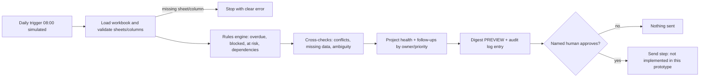

# Northstar Ops Agent: implementation note

All data is fictional. Nothing here contacts anyone, connects to a live system, edits the source workbook, or sends a message.

## Run it

```
pip install -r requirements.txt       # pandas, openpyxl, xlrd (original .xls), anthropic (model layer)
python ops_agent.py selftest            # 12 checks, regenerates every sample output
python ops_agent.py all                 # writes /outputs
python ops_agent.py ask "What is overdue right now?"
python ops_agent.py chat                # interactive rule-based agent (no API needed)

# Model-driven layer (needs your own Anthropic API key)
pip install anthropic
export ANTHROPIC_API_KEY=...            # optional: export ANTHROPIC_MODEL=<model name your account lists>
python llm_agent.py selftest            # offline checks with a fake client; no API call
python llm_agent.py chat                # Claude answers by calling the tools; every tool call is printed
python llm_agent.py triage              # Claude does the first-pass classification, same validator after it
```
`data/northstar.xlsx` is the supplied workbook converted from .xls (content unchanged); the code also reads the original .xls. The Drive copy includes `data/`. The GitHub copy leaves it out on purpose (it is the company's assessment file): to run from GitHub, put the workbook at `data/northstar.xlsx`.

## What it does, by challenge

| Challenge | File produced | What was built |
|---|---|---|
| 1. Monitoring agent | `agent_demo_transcript.md`, `project_health_report.md`, `facts_pack.json` | Deterministic tools compute overdue, blocked, at-risk, critical dependencies and project health. The agent answers questions from those tools and can show evidence (sheet, row, rule fired) for any task or project. |
| 2. Escalation workflow | `owner_followup_digest_MOCK.md` | Rules against the 13 Nov 2026 reference date, follow-ups grouped by owner and priority (P1-P3), a mock lead notification, and a "needs confirmation" section. |
| 3. Request triage | `triage_results.md/.json` | First-pass classifier, then a validator that checks safety, links requests to tasks, catches errors and routes to a human. |
| 1 and 3, model-driven | `llm_agent.py` | Claude tool-use agent over the same deterministic tools, plus an LLM first pass for triage. The model has no send/approve/edit tool; `propose_action` only queues a PENDING entry in `approval_queue.jsonl`. |
| 4. Improve and validate | below | Two improvements and success measures. |

## Workflow: trigger, inputs, steps, outputs, errors



- **Inputs:** Projects, Tasks, Task_Updates (digest); Sample_Inbox (triage); Weekly_Metrics (cross-check).
- **Error handling:** a missing sheet or column stops the run with a message. A row with missing data, an unknown dependency, or a conflict is reported in "Needs confirmation" and the affected rule is skipped. Nothing is guessed. `selftest` runs a corrupted copy to prove this.

## Rules (all explainable)

- **Overdue:** open and due date before the reference date. **Blocked:** Status = Blocked. **At risk:** forecast later than due date.
- **Critical dependency:** 2+ downstream tasks and (blocked, overdue, forecast 3+ days late, or a reported schedule risk).
- **P1:** Critical-priority task blocked/overdue, or a critical dependency that is blocked/overdue. **P2:** other blocked/overdue, critical dependency, due within 1 day and slipping, or Critical task slipping. **P3:** slipping only, or impacted by an upstream root cause (chase the root, not the symptom).
- **Project health:** RED if latest forecast is after the target date, or a Critical task is blocked/overdue, or 2+ tasks are blocked/overdue. AMBER if any task is blocked/overdue/slipping. Otherwise GREEN. The thresholds are my choices and can be tuned.

## Findings the data forced me to flag, not fix

- T-009 forecasts 16 Nov but its predecessor T-008 forecasts 17 Nov (conflict).
- T-002 and T-008 are waiting on someone the data never names (who confirms product facts; who gives written packaging sign-off).
- All 16 open tasks forecast later than their due date, so due dates may be stale baselines.
- Several dates fall on a weekend; working days are not defined.
- Project status labels mix workflow state and health (PRJ-103 "In Progress" is RED by rule).
- Only one week of metrics, so no trend can be computed.
- PRJ-101 is the borderline call (AMBER, 1-day margin, blocked chain T-002 to T-003 to T-004). I would review it with the lead.

## Triage: the error case it catches

REQ-006 ("The triage bot marked a routine billing question as urgent.") is mis-classified by the first-pass keyword stage as Billing / Urgent (the same failure Ava reports in T-016). The validator sees the message is about the system's own behaviour, re-classifies it as AI quality issue, flags the contradiction ("routine" vs "urgent"), keeps the wrong first-pass result visible, and routes it to human review. REQ-002 is the uncertain case: it could belong to PRJ-101 or PRJ-103, so it is flagged AMBIGUOUS_LINK and no lead is chosen for the user.

## Safeguards

- Read-only: the workbook is never written to.
- `send_notification()` refuses to run without a named approver and, even with one, live sending is deliberately not implemented.
- Status is never changed; approval and "mark complete" requests are blocked and need explicit written sign-off.
- Product claims are never produced; REQ-002 routes to whoever holds approved facts.
- The model-driven agent has no send, approve, status-change or write tool. `propose_action` writes a PENDING record and executes nothing.
- Every run writes an audit entry (input hash, counts, 0 sent, 0 records changed).

## What works and what does not (be exact)

- **Works and tested here:** loading, all rules, health, follow-ups, digest preview, triage, question answering, evidence, the safeguards (12/12 self-test checks).
- **Rule-based path vs model path:** `ops_agent.py ask/chat` and the default triage are rule-based and stand in for the model stage (the REQ-006 mis-classification is real output of those rules). `llm_agent.py` is the model-driven path: Claude calls the same tools (agent) or does the first-pass classification (triage), and the same validator runs after it.
- **Model layer: what is and is not verified.** Verified offline with a fake client (9 checks): the tool loop, refusal of tools that do not exist, capped loops, errors returned as results, `propose_action` only queues, the validator overriding a wrong first pass, unparseable model output sent to a human. **Not verified: any live call to the model.** The SDK and network were not available when this was built, so the first live run is yours; check the printed tool calls and answers against `agent_demo_transcript.md`.
- **Prompt-injection stance:** text inside the workbook (updates, inbox messages) is treated as data. The system prompt says so, the triage prompt repeats it, and the model has no tool that could act on an injected instruction.
- **Not built:** an n8n/Make flow (the mapping is: Schedule trigger, read workbook, Code node = rules, IF data issues, LLM summary, wait-for-approval, mock send), a live sender, a UI.
- **Needed to finish:** run `llm_agent.py` live with your own key, record the Loom, and paste the real model transcript into the submission.

## Challenge 4: two improvements before real use

1. **Audit trail and approvals (oversight, auditability).** Store every flag, the rule that fired, the reviewer, the decision and the time in a database, require two named roles (requester and approver) for any send or status change, and keep the wrong-then-corrected classifications as a test set.
2. **Replace the keyword first pass with an LLM plus an evaluation set.** Measure it on 100+ real labelled requests and set thresholds from the false-positive/negative rates, so no routine request is escalated as urgent and no urgent one is missed.

**How I would measure usefulness:** time to produce the weekly status (baseline vs after), overdue/blocked items detected before the owner reported them, false-alert rate (flags a lead dismissed), time from blocker raised to blocker resolved, and share of triage results a human accepted unchanged versus corrected.

## AI tools used (edit to reflect what you actually did)

Claude (Anthropic) was used to read the brief and workbook, write and test the Python prototype, draft the sample outputs and this note. The human submitter reviews, runs and demonstrates the build and remains accountable for the result.
